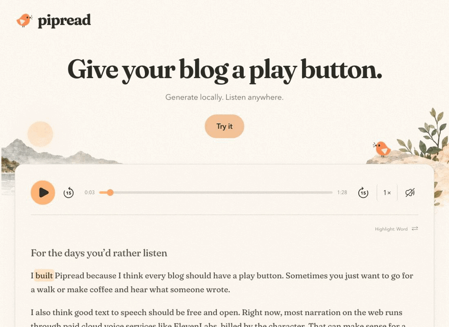

# Pipread


### Give your blog a play button.

Generate article narration locally, then publish ordinary audio files beside your posts. Readers get a small player immediately, with no model download or speech API key. The default player is framework independent and contains no speech inference runtime.

**Developer preview.** There is no published npm package; do not use `npx pipread`. Clone this source repository. Browser-local synthesis remains an optional local experiment whose compiled runtime distribution is still on hold.



*Actual website playback captured muted. Word markers use local acoustic forced
alignment; this GIF is not an audible alignment audit.*

## Website and branding

The complete [website](website/README.md) and its bird/landscape artwork are
included. Preview the prerecorded demo without downloading a voice model:

```sh
npm ci --ignore-scripts
npm run site:dev
```

The website's compact Highlight button cycles **Paragraph → Off → Word →
Paragraph**. The reusable blog component below keeps its existing checkbox:
unchecked means Off; checked follows supplied word intervals when present, with
paragraph fallback. They share timing data concepts, but are separate players.

`npm run build:site` prepares `dist-site/`; it does not deploy. Asset sources and
licenses are documented in [ASSETS.md](docs/ASSETS.md).

## Generate your posts

Requires Node 22.12+ and a supported native ONNX Runtime platform. Actual generation is tested on macOS Apple Silicon with Node 24.21.0; other operating systems and CI runners need validation. No Chrome is needed to generate narration.

```sh
git clone https://github.com/r3dbars/pipread.git
cd pipread
npm ci --ignore-scripts
```

Create `pipread.json` **in your blog project**. Paths are relative to that file; input and output directories must be separate. Output must initially be absent or empty.

```json
{
  "inputDir": "rendered-posts",
  "outputDir": "public/pipread",
  "selector": "article",
  "extensions": [".html"],
  "voice": "af_heart",
  "dtype": "fp32",
  "speed": 1,
  "paragraphPause": 0.3
}
```

```sh
# Inspect the plan first. No model download or file writes.
node /path/to/pipread/bin/pipread.mjs generate --config ./pipread.json
# Generate new/changed articles and publish a manifest:
node /path/to/pipread/bin/pipread.mjs generate --config ./pipread.json --write
```

Run exactly the same command after editing or adding posts. Unchanged narration is reused without loading the model. Deleted inputs disappear from the active manifest; their audio remains on disk so older deployed pages do not break. Nothing deletes old recordings automatically. Missing generated files are repaired; modified outputs are refused rather than silently replaced.

HTML extraction requires exactly one selector match. It excludes navigation, code, controls, hidden/ARIA-hidden/data-no-read elements and inline hidden styles. It does not execute scripts, fetch stylesheets, or calculate CSS class visibility. Use rendered static HTML and explicit `data-no-read` attributes; inspect the generated timing JSON transcript before publishing. `.txt` inputs are also supported, with blank lines separating paragraphs. Framework/Markdown source should be rendered to HTML first.

## Put the player beside an article

Publish the entire generated `public/pipread` directory at `/pipread/` on your static host. The manifest maps each path relative to `inputDir` to its audio and timings. For `rendered-posts/post.html`:

```html
<script type="module" src="/pipread/pipread-player.js"></script>
<pipread-audio manifest="/pipread/manifest.json"
  article="post.html" selector="#story"></pipread-audio>
<article id="story"><p>Your article…</p></article>
```

Or add that integration with a backup and dry-run first:

```sh
node /path/to/pipread/bin/pipread.mjs add --html ./post.html \
  --selector '#story' --manifest /pipread/manifest.json --article post.html
# Repeat with --write after reviewing the preview.
```

The CLI preserves unrelated HTML, creates a `.article-voice-backup`, refuses symlinks/conflicting players, and is idempotent. It does not deploy or copy assets into your hosting account. Nested posts use keys such as `notes/post.html`. Use `--script-url` when assets live elsewhere.

The player uses native audio controls for play/pause/seek, ±15-second skip buttons, pitch-preserving speed, and optional passage highlighting. A sidecar may also supply [word intervals](docs/WORD_TIMINGS.md), with paragraph fallback; the player does not estimate word times. Highlighting maps visible text to the transcript in order, preserving links and emphasis; changed or unmatched text gets no highlight. The CLI still generates exact synthesis-chunk boundaries, **not word alignment**. No forced scrolling. Serve over HTTP/HTTPS with `audio/wav` and working byte-range requests for seeking. Host cache policy should refresh `manifest.json` and `pipread-player.js`; content-hashed WAV/timing files may be cached immutably.

## Add genuine word timings

The CLI above generates paragraph/chunk timings only. For acoustic word alignment,
use the [separate pinned Python helper](tools/alignment/README.md): install its
isolated environment, download the optional English alignment model once, align
an existing WAV to its known transcript, then attach the resulting words to its
manifest. No `generate --align` flag exists. This step uses WhisperX on the CPU,
not equal-time interpolation, and does not regenerate the narration.

The additional alignment weights are about 378 MB. Reports preserve input hashes,
model revision and low-confidence words. Short words, names and pauses can still
be imperfect; review the report before publishing. The bundled 88.675-second demo
has 242 exact transcript tokens and a flagged short “to” interval. Readers need
no models, Python packages, API keys or paid service.

## Model, cost and privacy

One supplied English voice, Kokoro Heart (`af_heart`); no voice cloning. The local generator uses Kokoro-js 1.2.1, Transformers.js 3.8.1 and native ONNX CPU inference. Model revision and weights/voice hashes are pinned and verified. Default fp32 weights are **325,532,232 bytes**; optional `"dtype":"q8"` weights are **92,361,116 bytes**. Supporting tokenizer/config files and the installed voice/runtime add overhead. q8 output quality may differ; this new batch path's real inference validation used fp32.

The first generation downloads model files from Hugging Face and its download infrastructure. Those hosts receive IP/request metadata, not article text. The model cache defaults to `.pipread-cache/` beside the config; generation happens locally. There is no speech API key or paid inference endpoint. Generation still uses compute, memory, storage and power; hosting uses bandwidth and storage. Native ONNX Runtime emitted a telemetry device-ID warning in testing; we do not claim that the native library is telemetry-free. No project analytics or article-upload code is included. The published standalone player has no inference or analytics dependency.

## Incremental publishing / GitHub workflow

Build your blog's HTML, run `generate --write`, then publish your normal site plus the generated audio directory. Keep the previous output/manifest and model cache between runs to make generation incremental. If CI starts empty every time, it regenerates every post. Publish a consistent manifest/audio set atomically; don't point readers at a new manifest before its files exist.

For GitHub Actions, install the pinned source checkout and dependencies on a runner with Node and supported ONNX Runtime; cache `.pipread-cache` and persist the generated output directory as a build artifact or controlled repository content. Use your existing deployment step and permissions. An [illustrative step sequence](examples/github-steps.yml) shows where generation fits. It is not a deployment workflow. The repository now includes a test/build CI workflow; it does not generate speech, publish packages or deploy the website. Pin the Pipread commit you review in your workflow; review the transcript/audio diff before publishing. A local cache is an optimization, not the sole backup of published audio.

Every article's manifest record includes content/config hashes, exact model and voice identity, and WAV/timing integrity hashes. New audio uses immutable filenames. Manifest updates are atomic, with hash-named backups; an output lock prevents concurrent runs. If a process is killed, inspect its PID before manually removing `.pipread.lock`. Partial immutable files may remain for inspection. Existing user content and old published audio are never pruned.

## Run the demo and checks

```sh
npm run demo:audio  # locally prepares the included story; first run downloads model
npm run dev        # reusable-player integration sandbox
npm run site:dev   # branded website with committed demo audio
npm run check      # CLI + alignment attachment + website tests + both builds
npx playwright install chromium  # once, for optional browser tests
npm test           # mocked browser regression suite
npm run build      # static demo/player only; no speech runtime
```

`npm run build` includes locally generated demo assets if present. User-generated narration stays ignored; the approved website demo WAV and its timing/quality files are committed under `website/`. Safari, Firefox, mobile devices, background playback and offline use remain unverified. Narrow viewport checks are layout tests, not mobile playback certification.

See the [verification report](docs/STATIC_VERIFICATION.md) for actual results and remaining limits.

## Optional browser-local synthesis

Open `/examples/browser-local.html` on the local dev server. This optional component downloads a model on first use and synthesizes passages in a worker. `npm run build:browser-local` creates a separate `dist-browser-local` for **local evaluation only**. Do not host that runtime publicly yet. The [licensing review](docs/LICENSING.md), [release boundary](docs/RELEASE.md) and [source-built phonemizer experiment](experimental/phonemizer/README.md) explain the remaining work.

The default static publishing path ships generated narration and original player JS, without redistributing the synthesizer or model. This narrows the runtime-distribution issue; it is not a blanket legal clearance for every recording, article, voice or dependency. Original code is MIT except explicitly GPL-marked experimental adapter files; third-party components retain their licenses. See [notices](THIRD_PARTY_NOTICES.md).
